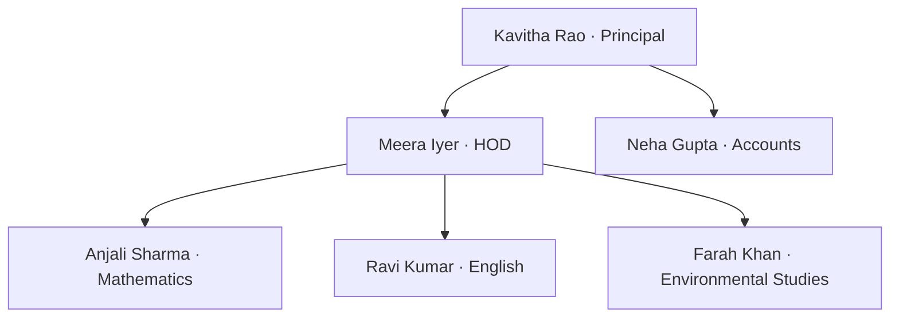

# Netaji Public School: Grade 4 pilot

Open **http://netaji.localhost:3000** (or http://localhost:3000). The sign-in form has a **Sample account** dropdown. All profiles below are synthetic local-demo identities.

There is one school, six class sections, ten student records (all in Grade 4 A) and ten logins. Anjali teaches Mathematics in Grade 4 A, Grade 4 B, Grade 5 A, Grade 5 B, Grade 6 A and Grade 6 B; the five added preview classes are empty. Each has a published weekday lesson, and the HOD can access all six classes. Ravi and Farah retain their Grade 4 A assignment. No admin, management, student-login or previous-school accounts are active in this database.

All ten accounts land on **School Feed** after sign-in and page reload. Teacher timelines remain under **My School Day**. The parent Home page remains available separately. Feed access still follows each account's audience and class permissions.

## Logins

All ten use password **`NetajiDemo!2026`**.

| Person | Login | Role / assignment |
|---|---|---|
| Anjali Sharma | anjali@netaji.school | Mathematics teacher; Grade 4 A class teacher |
| Ravi Kumar | ravi@netaji.school | English teacher |
| Farah Khan | farah@netaji.school | Environmental Studies teacher |
| Meera Iyer | hod@netaji.school | HOD, Primary School |
| Kavitha Rao | principal@netaji.school | Principal, head of school |
| Neha Gupta | accounts@netaji.school | Accounts / school finance |
| Sanjay Rao | incharge@netaji.school | Incharge, Grade 4 A and B |
| Priya Reddy | priya@netaji.school | Parent of Aarav Reddy |
| Suresh Rao | suresh@netaji.school | Parent of Ananya Rao |
| Pooja Sharma | pooja@netaji.school | Parent of Vihaan Sharma |

The local Netaji Principal and Accounts sample logins use email and the shared demo password only; no authenticator code is needed. This exception is restricted to these seeded accounts in the non-production embedded demo. Other schools and production retain their second-factor requirements. No email, SMS or live payment is sent by this setup.

## Reporting structure

All three teachers are assigned to Grade 4 A. Staff manager links route teacher leave to the HOD and HOD leave to the Principal. Accounts reports to the Principal separately from the teaching department. Detailed role permissions retain the existing baseline and can be refined one role at a time next.

## Students

| Admission number | Student | Linked parent login |
|---|---|---|
| NPS-4-001 | Aarav Reddy | priya@netaji.school |
| NPS-4-002 | Ananya Rao | suresh@netaji.school |
| NPS-4-003 | Vihaan Sharma | pooja@netaji.school |
| NPS-4-004 | Meera Patel | None yet |
| NPS-4-005 | Ishaan Verma | None yet |
| NPS-4-006 | Saanvi Iyer | None yet |
| NPS-4-007 | Arjun Nair | None yet |
| NPS-4-008 | Diya Menon | None yet |
| NPS-4-009 | Kabir Mehta | None yet |
| NPS-4-010 | Tara Joshi | None yet |

Each parent sees only their linked child. Student logins remain disabled. The other seven students do not get hidden parent accounts.

## Initial school data

- Academic year: 2026-2027; Grade 4 A; three subjects.
- Monday-Friday: Mathematics 09:00-09:45, English 09:50-10:35, Environmental Studies 10:50-11:35.
- School logo: a sample NPS crest, not an official supplied logo. City/state and production legal/contact details are not configured.
- Finance: default chart of accounts and a Tuition fee head, with no invented fee amounts, invoices, receipts or payments.
- At the user's request, Grade 4 A now includes labelled demo exams/results and daily attendance history. Assignments, syllabus and leave are not fabricated. See the exam testing steps below.

## Data and testing

The active database is **`.data/netaji-campus`**. The previous **`.data/campus`** and earlier recovery archives remain inactive backups and are not loaded by the app. Old demo credentials and Greenfield/Riverdale school hosts are absent from the active database. Reopening the app preserves edits and does not recreate or reset the pilot on every launch.

`pnpm db:setup` and `pnpm dev` now use this focused local setup. Production PostgreSQL is migrated without creating these demo identities. The old two-school fixture remains in isolated unit/security tests only. The default browser tests now target Netaji, cover all nine logins, verify old-login rejection and parent isolation, and exercise local OCR plus the two attendance review gates without submitting fake attendance.

Screenshots: [teacher desktop](screenshots/netaji-teacher-desktop.png), [teacher mobile](screenshots/netaji-teacher-mobile.png), [parent](screenshots/netaji-parent.png).

## Exams and student history demo (9 November 2026)

Sign in as Anjali, open **My Classes > Grade 4 A > Exams & marks**. The schedule shows seven exam cards, each containing its three subject papers (21 papers in total). Open an exam to choose a subject, or filter to Mathematics for direct mark entry. Exams are published schedules and automatically appear in the teacher School Calendar. School staff can use **School modules > Calendar > Schedule an exam**, then create, approve and publish the schedule under Exams. This uses a single exam record, rather than an unrelated calendar notice.

- Unit Tests 1/2, Quarterly and Half Yearly have fictional published results for all ten pupils, across Mathematics, English and EVS.
- Unit Test 3 (6 November) has three draft scores per subject, with seven students awaiting entry. Save drafts or review and submit the complete class. Submitted results require school approval and publication before parents can see them.
- Unit Test 4 (9 November) demonstrates the same-day lock; it opens on 10 November in the school timezone. Final Examination (15 March 2027) demonstrates an upcoming locked exam.
- History contains pass percentage, normalized class average, entered/missing results, and a follow-up count (selected exam below pass mark or recorded daily attendance below 75%). Metrics use the current roster; missing scores are not zeroes. Draft scores are explicitly included for teachers.
- Open a pupil for exam and monthly attendance graphs, subject filtering, recorded-day counts, change since the previous scored exam in the same subject, and a readable result record. Different maximum marks are normalized to percentages.
- There are 48 fictional weekday daily attendance records per student across June, July, September and October (480 total). No live-today attendance is submitted by the demo seed or browser tests. Attendance rates count recorded Present/Absent daily registers through yesterday in the academic year; missing days and period registers are excluded.

All demo exams have `(Demo)` in their names and fictional result/attendance notes. Initialization is local-only, audited, additive and applied once. Restarting preserves subsequent tester changes. The other five preview classes remain empty.

## Teacher subjects and class teacher access (12 November 2026)

Mark entry always follows the teacher's **published timetable assignments in the selected class**. Anjali can enter Mathematics, Ravi English, and Farah Environmental Studies. The API enforces this for individual mark creation/changes/actions and class-wide saves/submission. Draft/unpublished or removed assignments and ownership of old records do not grant subject permission.

A subject teacher sees only those subjects in exam/result history, student result graphs and performance reports. An **appointed class teacher** additionally sees all subject results for that class in History, while mark entry still contains only their own teaching subjects. Anjali is currently the appointed Grade 4 A class teacher. Her History includes overall pass percentage, class average, completion/follow-up counts and daily class attendance. Overall passing requires passing **every** subject paper in the selected exam; students with incomplete subject results are excluded from the pass denominator and average and counted as awaiting marks. Daily attendance is the common class register, not fabricated subject-period attendance.

HOD, Principal, Admin and a scoped Vice Principal (incharge) can use **School modules > Class teachers** to appoint/change/remove the class teacher. The appointment form allows only active teachers assigned to that class, requires a reason, checks the class version and records an audit event. HOD/incharge changes are restricted to their assigned classes. The new appointment takes effect on the next server read; refresh an open teacher class to update its screen.

## Local mock advertisements

The local `.env` opts into `ADS_DEMO_MODE=true`. This embedded-demo mode is ignored in production and with a PostgreSQL database. Teacher **My School Day**, parent **Home**, and allowed staff **Today** pages show a responsive, labelled sponsored container. School Feed remains its own tab. Use **Next example** to cycle three fictional sponsors, open the local offer preview, **Report ad** to try the demo interaction, or **Hide advertisement**. These are previews; they do not open advertiser sites, fetch third-party images, run tracking pixels, earn revenue, or send real ad reports. Live advertising remains controlled by `ADS_ENABLED`.

Mock ads bypass live frequency/content-density limits so they stay testable on the small demo home pages. Live placements retain those limits. Student and Accounts roles and classroom/marks/Diary screens do not receive these placements. Set `ADS_DEMO_MODE=false` and restart the API to disable the previews.

Diary entries now have no title field, prefill the teacher's assigned subject for the selected class, and label the body **Diary**. If a teacher has multiple teaching subjects in the class, the prefilled subject can be changed only among those assignments. The two standalone Class diary/Assignments shortcut cards have been removed from My School Day; class pages retain their tabs.

Rich-media expansion: School Feed now includes native sponsored image/video cards between school posts, and teacher My Classes has a directory placement. In the small demo, the first feed post is followed by an image example; use Next example for the playable eight-second video. Larger live feeds use the spacing described in AD_PLACEMENTS.md. Images/video are local same-origin creative assets. Opening a classroom does not retain the directory placement. The school announcement audience filter was corrected so teachers receive published announcements matching their assigned classes.

Driver demo: Ramesh Yadav, driver@netaji.school, shared password NetajiDemo!2026. Priya now has two linked children: Aarav Reddy and Diya Menon. See BUS_TRACKING.md for simultaneous driver/parent testing.

## Student accounts

The ten Grade 4 A pupils now have individual student logins at `/student`. Choose a sample student or use `aarav.reddy` with demo PIN `240426`. See [Student workspace](STUDENT_WORKSPACE.md) for features and office provisioning/PIN resets. Demo seeding preserves later changes.
